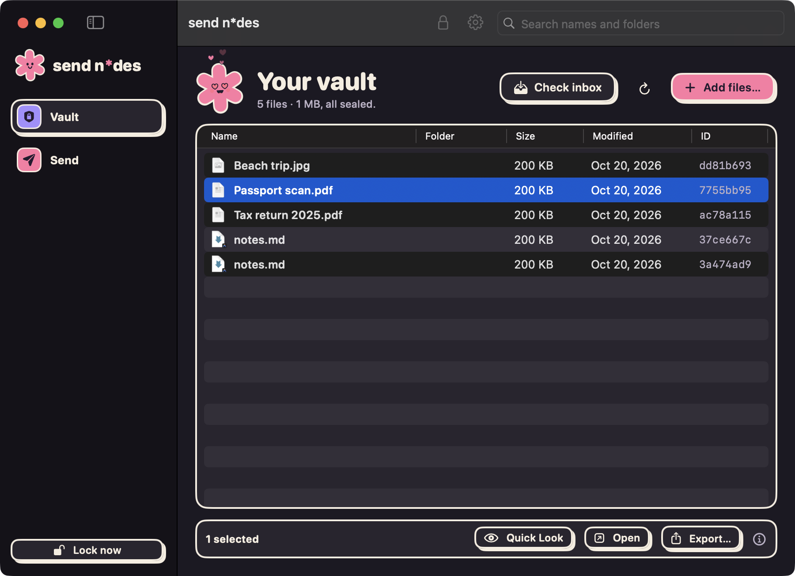
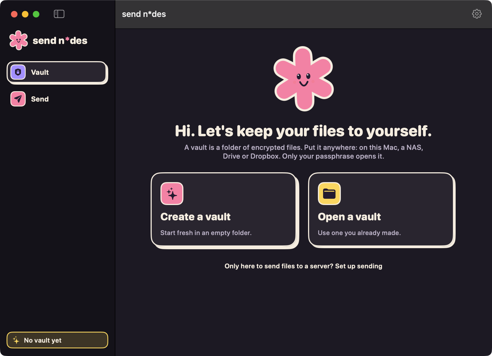
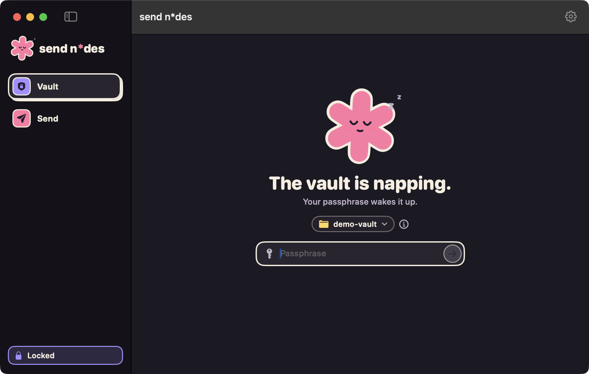
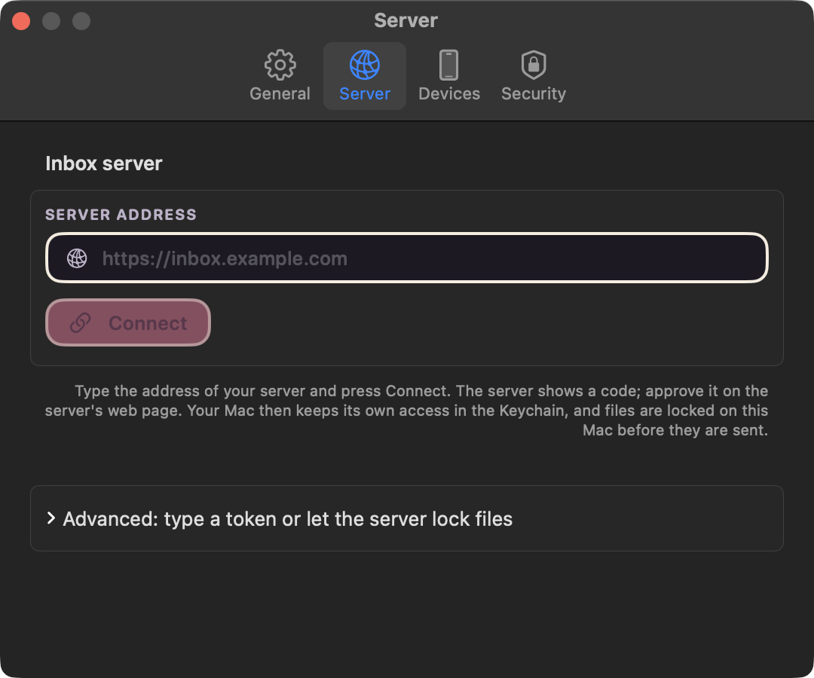
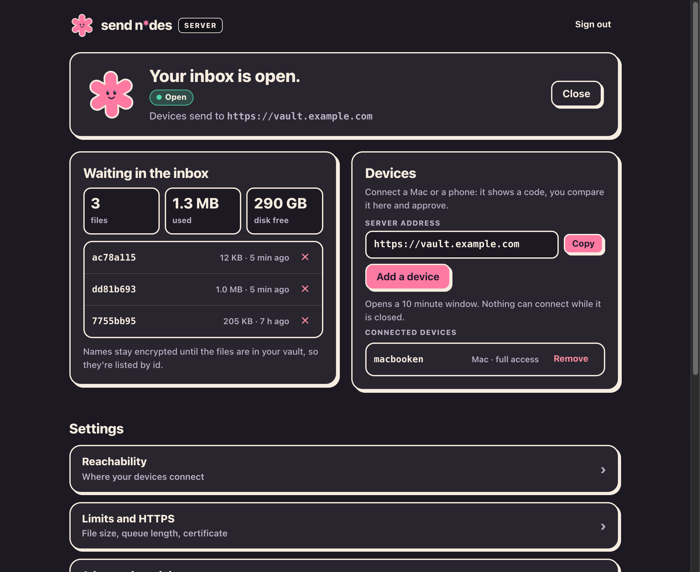
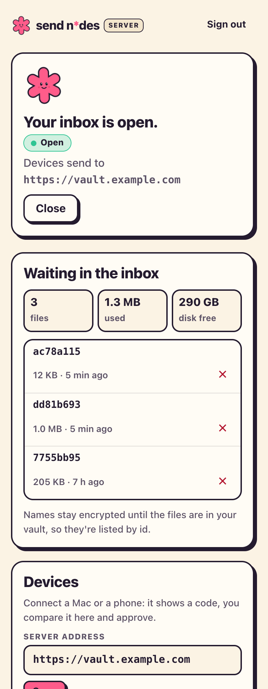
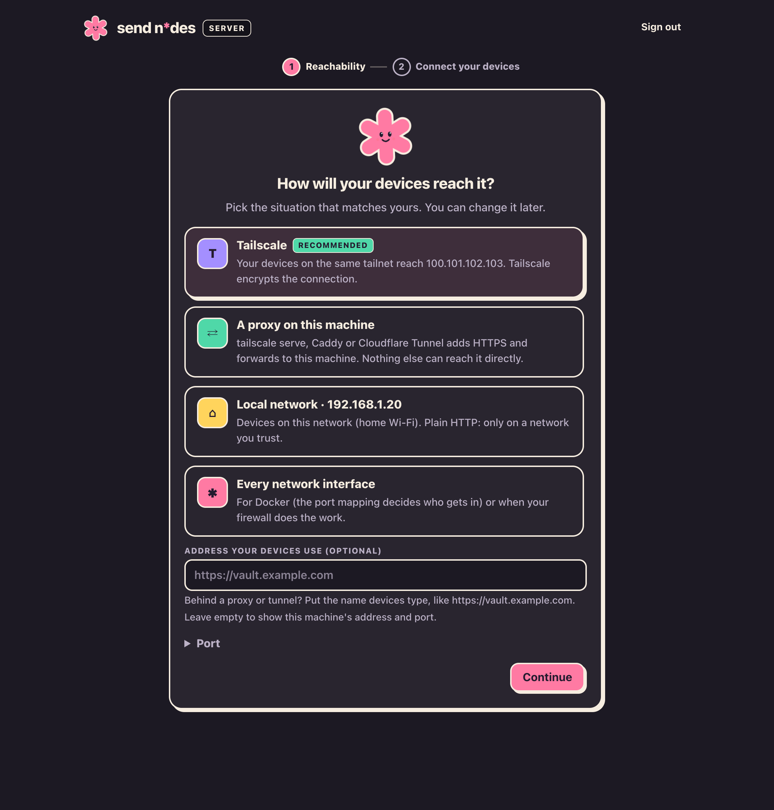

<h1 align="center">send n*des</h1>

<p align="center">
  <b>A private vault for your files, and an inbox your devices can drop them into.</b><br>
  Contents, names and folders stay encrypted, wherever the vault is stored or synced.
</p>

<p align="center">
  
</p>

> **Made by machines, for one person.** This was designed and written by AI, carefully, then attacked by other AI reviewers and cross-checked by three independent implementations (Go, Swift, Python) that agree byte for byte. No human cryptographer has audited it, and none is planned. It was built to satisfy its creator, nobody else, so there are no promises here about anyone else's data. Everything is entropy in the end, ciphertext included. Keep a plaintext backup of anything you can't lose anyway.

## What's in the box

| Piece | What it does |
|---|---|
| **Vault** | A folder of encrypted files. Put it anywhere: this Mac, a NAS, Google Drive, Dropbox. Whoever hosts or syncs it sees only ciphertext. |
| **Mac app** (`send n*des`) | Create, unlock and browse the vault; add, Quick Look, open and export files; send files to your inbox server. |
| **iPhone app** (`ios/`) | Send-only: share photos and files from any app to your inbox. Encrypts on the phone, retries in the background. |
| **Inbox server** (`ndesd`) | A write-only drop box your devices send to, with a web admin page. It can never read the vault. Devices connect by approving a code on its page. |
| **CLI** (`ndes`) | Everything the app does, plus verify, recover and change the passphrase. |

```
 Mac / iPhone ──send (encrypted on the device)──> ndesd inbox
                              │
 Mac app or ndes ──pull───────┘──> vault folder (local, NAS, Drive, Dropbox…)
```

Runs on macOS and Linux (not Windows), plus iOS for the phone app. The format has independent implementations in Go and Swift (and a Python cross-check) that agree byte for byte ([SPEC.md](SPEC.md)).

## The Mac app

<table>
  <tr>
    <td width="50%"></td>
    <td width="50%"></td>
  </tr>
  <tr>
    <td><b>First launch.</b> Create a vault or open one you already have.</td>
    <td><b>Locked.</b> Passphrase or Touch ID. Switch between recent vaults from the folder menu.</td>
  </tr>
  <tr>
    <td></td>
    <td></td>
  </tr>
  <tr>
    <td><b>Unlocked.</b> Drop files in, press Space for Quick Look, export when you need a copy. Files that arrived from the inbox are tagged <i>new</i>.</td>
    <td><b>Connect.</b> Enter the server address, press Connect and approve the code on the server's page. Sending then works while the vault is locked.</td>
  </tr>
</table>

- Locks after inactivity (1–120 min), and at once on sleep, screen lock or user switch.
- Unlocking checks the inbox and brings new files in by itself (can be turned off in Settings).
- The recovery key is shown once at creation; you confirm three random groups of it before you can continue.
- Keyboard: ⌘O add, ⌘R refresh, ⇧⌘I check inbox, ⌘L lock, ⌘, settings.

## The inbox server

<table>
  <tr>
    <td width="68%"></td>
    <td width="32%"></td>
  </tr>
  <tr>
    <td colspan="2"></td>
  </tr>
</table>

The admin page walks you through setup once: **claim** the server with the one-time code, choose **how your devices reach it** (Tailscale, a proxy on the machine, the local network or every interface), then **connect your devices**. After that it shows status, what's waiting, the Devices card and settings.

**Connecting a device** needs no copying of tokens: in the Mac app (Settings → Server) or the iPhone app, type the server address and press Connect. The app shows a six-digit code. Press *Add a device* on the server page (it opens a ten-minute window), compare the codes and approve. Each device gets its own token, stored hashed on the server, and you can remove a device at any time to cut it off. If the admin page and the sync address differ (a proxy or tunnel), set **Address your devices use** under reachability so the page shows `https://vault.example.com` rather than a host and port.

**Start over** (after signing in) removes the devices, reachability settings, pasted keys or waiting files you tick, and runs the setup again.

The server never holds a secret that can open anything. Devices encrypt files with the vault's *public* inbox key, which they learn while pairing; the server itself needs no keys unless you opt in to server-side encryption for scripts and curl.

## Quick start

You need Go 1.27.3+ (and Swift for the Mac app).

### 1. Build

```bash
go build -o ndes ./cmd/ndes          # CLI
scripts/build-app.sh                 # Mac app -> build/sendndes.app
scripts/build-linux.sh               # release binaries into dist/ (ndesd for Linux, ndes for Mac)
```

For a code signature that stays stable between builds (so the Keychain keeps trusting the app), set `SIGN_IDENTITY="Apple Development: Name (TEAMID)"`.

### 2. Make a vault

Open `build/sendndes.app` and choose **Create a vault**, or use the CLI:

```bash
./ndes init ~/MyVault                # prints the recovery key: write it down
export NDES_VAULT=~/MyVault          # or pass --vault after the command
./ndes add photo.jpg
./ndes ls
./ndes get <id> -o photo.jpg
```

### 3. Run the inbox server (optional)

With Docker, on the machine that will receive files:

```bash
docker compose up -d
docker compose logs ndesd            # shows the one-time setup code
```

Open <http://127.0.0.1:8080> and follow the setup. To pull from the command line instead of the Mac app:

```bash
./ndes pull --server http://<tailscale-ip>:8485 --token-file token.txt
```

#### Prebuilt image

Run the **Docker image** workflow from the repo's Actions tab (it publishes `ghcr.io/klppl/sendndes`). If the package is private, make it public or `docker login ghcr.io` on the server. Then save this as `docker-compose.yml` on the server:

```yaml
services:
  ndesd:
    image: ghcr.io/klppl/sendndes:latest
    restart: unless-stopped
    # Only if the admin page is behind a Cloudflare Tunnel / reverse proxy. Protect the
    # hostname with a Cloudflare Access policy too (see coordination/ndesd-deploy.md).
    # environment:
    #   NDESD_ADMIN_BEHIND_PROXY: "1"
    volumes:
      - ndesd-data:/data
    ports:
      - "127.0.0.1:8080:8080"   # admin page, this machine only
      - "8485:8485"             # sync port: put on Tailscale or behind HTTPS
volumes:
  ndesd-data:
```

```bash
docker compose pull && docker compose up -d
```

The sync port (8485) speaks plain HTTP: keep it on Tailscale or a VPN, or put HTTPS in front of it. The admin page only answers this machine, the local network and Tailscale; reach it remotely over an SSH tunnel or Tailscale. More options (systemd, Cloudflare Tunnel, limits): [coordination/ndesd-deploy.md](coordination/ndesd-deploy.md).

## Security in short

**Protected:** file contents, names and folder structure, against the storage host, the sync service and the inbox server. Any change to a file is detected. Argon2id for the passphrase, ChaCha20-Poly1305 for content, X25519 for inbox uploads ([SPEC.md §2](SPEC.md)).

**Visible to the host:** how many files there are, their approximate sizes (padded up to at most 12.5% above the real size, minimum 4 KiB, so small files look alike), and modification times.

**Not protected:** malware on an unlocked device, a weak passphrase, a lost passphrase *and* recovery key (the data is gone), and a host deleting files or rolling them back to an older version.

**Good to know**
- Encrypted-on-device upload: the Mac and iPhone apps encrypt files on the device with `inbox_pub` and `K_auth` before sending (`PUT /inbox/{id}`); the inbox server never sees plaintext, filenames, or folder structure. Server-side encryption (`PUT /inbox`) exists only for scripts and curl and only if you gave the server the vault's keys; then it sees the file for a moment while it encrypts. Either way, keep the sync port on Tailscale or behind HTTPS; the apps refuse plain HTTP to anything else.
- Device tokens are stored hashed on the server, with separate upload and pull roles, per-client rate limits and a short, closed pairing window. Behind Cloudflare see [coordination/ndesd-cloudflare.md](coordination/ndesd-cloudflare.md).
- Padding hides exact sizes but not roughly how big a file is.
- The apps keep the device token and encryption keys in the Keychain (never iCloud-synced). Opened and Quick Look copies live in a private temporary folder that's emptied on lock and quit; exports stay where you put them.

Full threat model: [SPEC.md §7](SPEC.md). App details: [app/README.md](app/README.md).

## CLI reference

```
ndes init <vault-dir>                       create a new vault
ndes add <file> [--dir <path>] [--name <n>] encrypt a file into the vault
ndes ls [--dir <path>]                      list files
ndes get <id-or-path> [-o <out>]            decrypt a file
ndes pull --server <url> --token-file <f>   pull encrypted files from a ndesd server
ndes ingest [--inbox <dir>]                 move encrypted inbox files into the vault
ndes verify                                 authenticate every file in the vault
ndes passwd                                 change the passphrase
ndes recover <vault-dir>                    rebuild vault.json from the recovery key
ndes recovery-key                           print the recovery key
ndes server-config                          print the inbox server's keys
```

Common flags: `--vault <dir>` (default `$NDES_VAULT`, then `.`), `--passphrase-stdin`. Run `ndes --help` for the rest.

## Development

```bash
go test ./...                # Go: core, CLI, server
scripts/test-app.sh          # Mac app core tests (builds a real helper and server)
```

| Path | What's there |
|---|---|
| `core/` | Go reference implementation of the format |
| `cmd/ndes`, `cmd/ndesd` | CLI and inbox server (admin page in `cmd/ndesd/web`) |
| `app/` | Mac app (SwiftUI); it runs the bundled `ndes` as a checked helper |
| `ios/` | iPhone send-only app and share extension (XcodeGen) |
| `swift/NdesCore` | Swift implementation of the format |
| `testvectors/` | Shared vectors both implementations must match |
| `coordination/` | Design notes, reviews and decisions, including the UX write-ups for the [app](coordination/app-ux-v1.md) and the [server](coordination/ndesd-ux-v1.md) |

## License

[The Lagom License](LICENSE) ([klppl.github.io/lagom-license](https://klppl.github.io/lagom-license/)). Copyright (c) 2026 klppl.
